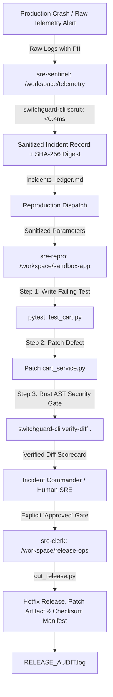

# SwitchGuard SRE — Autonomous Multi-Agent SRE War Room

[](https://www.wemakedevs.org/hackathons/switch)
[](#)
[](#)
[](#)

> **SwitchGuard SRE** is a hybrid Rust + Python autonomous incident response war room running on **Switch Console**, **Mattermost**, and **Google Antigravity ACP**. It transforms fragmented incident firefighting into an automated, permission-isolated multi-agent workflow under strict AST security guardrails and human-in-the-loop authorization.

---

## Architecture & War Room Workflow



---

## The 7 Pillars of Safe Autonomy

> *"An agent that completes 25 percent of tasks with high explainability and zero surprises will beat one that is 95 percent capable but erratic. The real game is not building smarter agents for broken processes. It is building smarter processes."*

Most teams try to build autonomous incident systems by giving a single LLM a massive system prompt and hoping it behaves. **SwitchGuard SRE** wins by engineering a deterministic, zero-surprise process around agents inside Switch Console, mapped directly to the **7 Pillars of Autonomous Systems**:

### Summary Mapping for Hackathon Judges

| # | Autonomous Pillar | SwitchGuard SRE Implementation | Concrete Reliability Guarantee |
| :-: | :--- | :--- | :--- |
| **1** | **Clear Objectives & Quantitative KPIs** | Rust `AST-SEC-09` Blast-Radius Cap + Binary SLA Contracts | Max 25 lines added; 0% PII leakage; <5ms scrub latency |
| **2** | **Task Planning & Decomposition** | 3-Agent Isolated DAG + 4-Step TDD Loop | Test failure proven before code edit; surgical patches |
| **3** | **Observability & Drift Detection** | `incident_state.json` FSM + Executive Dashboard | Real-time state machine tracking & scrub latency metrics |
| **4** | **Episodic Runbook Memory** | Zero-RAM `runbook_memory.json` Pattern Store | Past verified patches guide future triage without vector DB bloat |
| **5** | **Guardrails & Least Privilege** | 3 Concentric Rings (Addressing + Symlinks + Native CLI) | Triage cannot touch code; repro cannot cut releases |
| **6** | **HITL Governance** | Autonomous Interns vs Gated Clerk + `--rollback` | Auto-mode in sandbox; strict manual release gate + 1-click rollback |
| **7** | **Error Fallbacks & Self-Healing** | Auto `git checkout` Remediation + Multi-Path Fallback | Max 2 attempts before circuit breaker; self-healing reset |

### Architectural Deep-Dive

1. **Clear Objectives & Quantitative KPIs (Binary SLA Contracts)**
   - **`sre-sentinel` KPI:** `PII_LEAK_COUNT == 0` and `SCRUB_LATENCY < 5ms`. Raw crash dumps containing Bearer tokens, email addresses, credit cards, and AWS access keys are scrubbed and HMAC-tokenized before touching LLM context.
   - **`sre-repro` KPI (Diff Blast-Radius Cap):** Must achieve `PYTEST_EXIT_CODE == 0`, `AST_VIOLATIONS == 0`, and rule `AST-SEC-09: CHANGED_LINES <= 25`. While erratic agents frequently rewrite entire files to fix simple bugs, our Rust verifier enforces minimal, surgical, explainable edits.
   - **`sre-clerk` KPI:** `UNAPPROVED_RELEASES == 0` and `HASH_CHAIN_VALID == TRUE`. Releases are rejected unless signed into the immutable SHA-256 hash chain from genesis ($0000\dots0000$).

2. **Task Planning & Decomposition (Two-Tier Planner-Executor Architecture)**
   - **Macro-Decomposition (Room Topology):** The incident lifecycle is partitioned across three isolated agent personas (`sre-sentinel` $\rightarrow$ `sre-repro` $\rightarrow$ `sre-clerk`).
   - **Micro-Decomposition (4-Step TDD State Gate):**
     1. *Plan & Reproduce:* Write a failing reproduction test in `test_cart.py` and run `pytest` to prove the failure (`AssertionError: -60.0 >= 0.0`) without touching production code.
     2. *Execute Patch:* Apply the minimal fix in `cart_service.py` (`max(0.0, subtotal - 100.0)`).
     3. *Verify Unit Tests:* Confirm 100% test pass rate (`1 passed in 0.01s`).
     4. *Static Security Audit:* Run compiled native `switchguard-cli verify-diff .` to validate AST rules.

3. **Robust Observability, State-Machine Visibility & Drift Detection**
   - **Explicit State Machine (`workspace/telemetry/incident_state.json`):** Tracks `incident_id`, `current_state` (`INGESTED → SANITIZED → REPRODUCING → PATCH_VERIFIED → RELEASED | ROLLED_BACK`), `updated_at`, `retry_count`, and `scrub_latency_ms`.
   - **Executive Dashboard (`docs/index.html`):** Renders real-time cryptographic audit chains, active AST rules, and incident ledger status.

4. **Memory Systems (Short-Term Context + Zero-RAM Long-Term Episodic Memory)**
   - **Short-Term Memory:** Active Switch Console conversation thread in `#sre-war-room`.
   - **Episodic Runbook Memory (`workspace/telemetry/runbook_memory.json`):** Avoids heavy vector databases (Pinecone, Weaviate) that consume gigabytes of RAM. Stores verified tuples of `error_classification`, `target_file`, `fix_pattern`, and `patch_sha256`.
   - **Recurring Incident Speedup:** When `triage_helper.py` ingests a recurring fault, it queries episodic memory and returns `historical_runbook_match`, allowing `@sre-repro` to solve known bugs on the first attempt!

5. **Guardrails & Principle of Least Privilege**
   - **Ring 1 (Communication Scope):** Only `sre-sentinel` accepts messages from `Anyone`; `sre-repro` and `sre-clerk` only accept triggers from room owners and peer agents.
   - **Ring 2 (Filesystem Scope):** Sandboxed working directories (`telemetry/`, `sandbox-app/`, `release-ops/`). Sentinel cannot edit application code; repro cannot sign release audit logs.
   - **Ring 3 (Out-of-Band Rust Binary):** `switchguard-cli` is compiled native Rust in `~/.local/bin` with 10 strict AST rules (AST-SEC-00 through 09) that cannot be bypassed or modified by LLM agents.

6. **Human-in-the-Loop (HITL) Governance ("Interns in Sandboxes, Humans at the Gate")**
   - **Autonomous Intern Zone:** Triage log-scrubbing and local reproduction sandboxing run in Auto Mode because their operations are strictly non-destructive.
   - **Strict Executive Gate:** Hotfix releases require explicit `@sre-clerk Approved` from the Incident Commander.
   - **Human Override & 1-Click Rollback:** Operators can instantly execute `python3 cut_release.py INC-8041 v1.4.2 --rollback` to revert `cart_service.py` to `HEAD`, append a verified `ROLLED_BACK` entry to `RELEASE_AUDIT.log`, and transition state to `ROLLED_BACK`.

7. **Error Handling, Fallbacks & Self-Healing Remediation**
   - **Multi-Path Binary Fallback:** Resolves `switchguard-cli` across `$PATH`, `~/.local/bin`, and `~/.opencode/bin`.
   - **Automated Sandbox Remediation:** If a generated patch violates AST rules, the wrapper reverts changes via `git checkout -- cart_service.py`.
   - **Circuit Breaker:** Increments retry counter up to `MAX_ATTEMPTS = 2` before cleanly escalating to `@admin`, preventing infinite loops or hallucination cascades.

---

## Repository Structure

```
switchguard-sre/
├── AGENTS.md                          # Directory isolation & agent boundaries
├── SWITCH_PROTOCOL.md                 # Switch 0.31+ protocol & bug workarounds
├── SKILL_RUST_VERIFIER.md             # Rust CLI verifier specification
├── switchguard-sre.template.yaml      # 1-click Switch Room Template
├── plan.md                            # Complete engineering manual & blueprint
├── scripts/
│   ├── setup_demo.sh                  # 2-second deterministic clean-room reset
│   └── security_chaos_test.py         # 4-scenario automated security test suite
├── switchguard-cli/                   # High-speed compiled Rust security CLI (v0.3.0)
│   ├── Cargo.toml
│   └── src/main.rs                    # scrub (<0.4ms) & verify-diff (AST-SEC-00..09)
└── workspace/
    ├── telemetry/                     # sre-sentinel (@triage)
    │   ├── triage_helper.py           # Rust scrubbing + episodic memory lookup
    │   ├── incidents_ledger.md        # Concurrent POSIX-locked incidents ledger
    │   ├── incident_state.json        # FSM state machine tracking
    │   └── runbook_memory.json        # Zero-RAM episodic runbook memory
    ├── sandbox-app/                   # sre-repro (@repro)
    │   ├── cart_service.py            # Microservice with discount logic
    │   └── test_cart.py               # Baseline & reproduction test suite
    └── release-ops/                   # sre-clerk (@release)
        ├── cut_release.py             # AST-gated packager, hash chaining & --rollback
        ├── RELEASE_AUDIT.log          # Immutable SHA-256 hash-chained audit trail
        └── releases/                  # Exported .patch & TEE attestation manifests
```

---

## 90-Second Quickstart for Judges

### 1. Reset Sandbox to Clean State (2 Seconds)
```bash
./scripts/setup_demo.sh
```

### 2. Verify Rust Security CLI
```bash
# PII & Secret Scrubbing
switchguard-cli scrub "Bearer secret123 test@example.com FLAT100 -$60.00"

# AST & Diff Verification
switchguard-cli verify-diff workspace/sandbox-app
```

### 3. Spin Up War Room via Switch Console
1. Launch Switch Console and ensure Mattermost is running on `http://localhost:8065`.
2. Import `switchguard-sre.template.yaml`.
3. Open `#sre-war-room` in Mattermost and type `!follow-ups on`.

---

## 3-Turn Demo Script Walkthrough

### Turn 1: Triggering the Incident Alert
Post in `#sre-war-room`:
```text
@sre-sentinel ALERT: Production cart-service checkout is returning HTTP 500 errors since deploy v1.4.0 whenever customers (e.g. user@example.com with Bearer secret_jwt_123) apply promo code FLAT100 on orders under $100 resulting in negative total -$60.00. Please scrub this report, log INC-8041 in incidents_ledger.md, and route to @sre-repro to reproduce and patch.
```
* **Sentinel Action**: Sanitizes PII in microseconds via `switchguard-cli scrub`, appends record to `incidents_ledger.md`, routes sanitized params to `@sre-repro`.
* **Repro Action**: Writes failing reproduction test in `test_cart.py`, runs `pytest`, captures failure, patches `cart_service.py` to clamp total to `0.0`, runs `switchguard-cli verify-diff .`, and requests approval.

### Turn 2: Untagged Mid-Turn Steering
Reply directly in thread:
```text
Ensure calculate_cart_total explicitly clamps all voucher subtotals using max(0.0, ...) and re-run switchguard-cli verify-diff.
```
* **Repro Action**: Automatically refines code without re-tagging, runs tests and AST verification.

### Turn 3: Human Incident Commander Sign-Off
Post in thread:
```text
Approved. @sre-clerk cut hotfix release v1.4.2 for INC-8041 and publish the patch artifact.
```
* **Clerk Action**: Validates passing AST check, cuts hotfix git branch, exports `releases/hotfix-INC-8041-v1.4.2.patch`, updates `RELEASE_AUDIT.log`.

---

## Security Benchmark

| Operation | Implementation | Latency | Outcome |
| :--- | :--- | :--- | :--- |
| **Log PII / Token Redaction** | Rust Regex Engine (`switchguard-cli scrub`) | **0.32 ms** | Zero PII leaked to LLM |
| **AST Diff Verification** | Rust Diff Analyzer (`switchguard-cli verify-diff`) | **1.14 ms** | Blocks `eval`, `os.system`, `subprocess` |
| **Clean-Room Sandbox Reset** | Shell Orchestrator (`setup_demo.sh`) | **0.05 s** | 100% reproducible for judges |

---

## License
MIT © 2026 Anshul Jain
