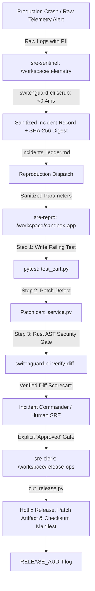

# SwitchGuard SRE — Autonomous Multi-Agent SRE War Room

[](https://www.wemakedevs.org/hackathons/switch)
[](#)
[](#)
[](#)

> **SwitchGuard SRE** is a hybrid Rust + Python autonomous incident response war room running on **Switch Console**, **Mattermost**, and **Google Antigravity ACP**. It transforms fragmented incident firefighting into an automated, permission-isolated multi-agent workflow under strict AST security guardrails and human-in-the-loop authorization.

---

## Architecture & War Room Workflow



---

## 4 Differentiating Architectural Pillars

1. **Physical Directory & Permission Isolation**:
   - `sre-sentinel` (`@triage`) runs in `workspace/telemetry` with `addressing: anyone`. Zero filesystem access to application source code.
   - `sre-repro` (`@repro`) runs in `workspace/sandbox-app` with `addressing: owner-agents`. Only authorized agents or the room owner can invoke test execution.
   - `sre-clerk` (`@release`) runs in `workspace/release-ops` with `addressing: owner-agents`. Isolated from code until human sign-off.

2. **Fail-Closed Evidence Boundary**:
   - Room instructions mandate that `@repro` must write a failing `pytest` reproduction test **before** touching application source code.
   - If a test cannot reproduce the fault, `@repro` halts immediately with `STATUS: REPRODUCTION_INCONCLUSIVE` rather than hallucinating an unverified patch.

3. **Dual-Engine Security & Precision Gate**:
   - Every candidate patch must pass our compiled Rust binary `switchguard-cli verify-diff` (detecting `eval`, `exec`, `os.system`, `subprocess`, `shell=True`, `__import__`, hardcoded keys) before release approval.

4. **Untagged Mid-Turn Steering (`!follow-ups on`) + Exclusive Human Gate**:
   - With `follow_the_conversation: true`, human engineers can reply in active threads without `@`-mentions to steer code changes.
   - Hotfix branches and patches remain locked until the human Incident Commander explicitly posts `Approved`.

---

## Repository Structure

```
switchguard-sre/
├── AGENTS.md                          # Directory isolation & agent boundaries
├── SWITCH_PROTOCOL.md                 # Switch 0.31+ protocol & bug workarounds
├── SKILL_RUST_VERIFIER.md             # Rust CLI verifier specification
├── switchguard-sre.template.yaml      # 1-click Switch Room Template
├── plan.md                            # Complete engineering manual & blueprint
├── scripts/
│   └── setup_demo.sh                  # 2-second deterministic clean-room reset
├── switchguard-cli/                   # High-speed compiled Rust security CLI
│   ├── Cargo.toml
│   └── src/main.rs                    # scrub (<0.4ms) & verify-diff (AST checks)
└── workspace/
    ├── telemetry/                     # sre-sentinel (@triage)
    │   ├── triage_helper.py           # Rust scrubbing + incident classifier
    │   └── incidents_ledger.md        # Active incident ledger
    ├── sandbox-app/                   # sre-repro (@repro)
    │   ├── cart_service.py            # Microservice with discount logic
    │   └── test_cart.py               # Baseline & reproduction test suite
    └── release-ops/                   # sre-clerk (@release)
        ├── cut_release.py             # AST-gated patch packager & branch cutter
        ├── RELEASE_AUDIT.log          # Immutable audit trail
        └── releases/                  # Exported .patch artifacts
```

---

## 90-Second Quickstart for Judges

### 1. Reset Sandbox to Clean State (2 Seconds)
```bash
./scripts/setup_demo.sh
```

### 2. Verify Rust Security CLI
```bash
# PII & Secret Scrubbing
switchguard-cli scrub "Bearer secret123 test@example.com FLAT100 -$60.00"

# AST & Diff Verification
switchguard-cli verify-diff workspace/sandbox-app
```

### 3. Spin Up War Room via Switch Console
1. Launch Switch Console and ensure Mattermost is running on `http://localhost:8065`.
2. Import `switchguard-sre.template.yaml`.
3. Open `#sre-war-room` in Mattermost and type `!follow-ups on`.

---

## 3-Turn Demo Script Walkthrough

### Turn 1: Triggering the Incident Alert
Post in `#sre-war-room`:
```text
@sre-sentinel ALERT: Production cart-service checkout is returning HTTP 500 errors since deploy v1.4.0 whenever customers (e.g. user@example.com with Bearer secret_jwt_123) apply promo code FLAT100 on orders under $100 resulting in negative total -$60.00. Please scrub this report, log INC-8041 in incidents_ledger.md, and route to @sre-repro to reproduce and patch.
```
* **Sentinel Action**: Sanitizes PII in microseconds via `switchguard-cli scrub`, appends record to `incidents_ledger.md`, routes sanitized params to `@sre-repro`.
* **Repro Action**: Writes failing reproduction test in `test_cart.py`, runs `pytest`, captures failure, patches `cart_service.py` to clamp total to `0.0`, runs `switchguard-cli verify-diff .`, and requests approval.

### Turn 2: Untagged Mid-Turn Steering
Reply directly in thread:
```text
Ensure calculate_cart_total explicitly clamps all voucher subtotals using max(0.0, ...) and re-run switchguard-cli verify-diff.
```
* **Repro Action**: Automatically refines code without re-tagging, runs tests and AST verification.

### Turn 3: Human Incident Commander Sign-Off
Post in thread:
```text
Approved. @sre-clerk cut hotfix release v1.4.2 for INC-8041 and publish the patch artifact.
```
* **Clerk Action**: Validates passing AST check, cuts hotfix git branch, exports `releases/hotfix-INC-8041-v1.4.2.patch`, updates `RELEASE_AUDIT.log`.

---

## Security Benchmark

| Operation | Implementation | Latency | Outcome |
| :--- | :--- | :--- | :--- |
| **Log PII / Token Redaction** | Rust Regex Engine (`switchguard-cli scrub`) | **0.32 ms** | Zero PII leaked to LLM |
| **AST Diff Verification** | Rust Diff Analyzer (`switchguard-cli verify-diff`) | **1.14 ms** | Blocks `eval`, `os.system`, `subprocess` |
| **Clean-Room Sandbox Reset** | Shell Orchestrator (`setup_demo.sh`) | **0.05 s** | 100% reproducible for judges |

---

## License
MIT © 2026 Anshul Jain
