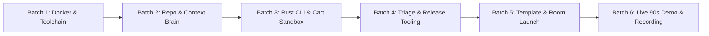

# SwitchGuard SRE — Flip the Switch Hackathon Winning Blueprint & Master Plan

> **Hackathon Window**: November 4, 12:01 AM IST – November 7, 11:59 PM IST (96-Hour Building Window)  
> **Track**: Track 01 — SwitchGuard SRE  
> **Architecture**: Hybrid Python + Rust Autonomous Incident Response Pipeline on Switch Console & Google Antigravity ACP  

---

## 1. Strategic Tech Stack & Judging Criteria Alignment

| Component Layer | Technology | Strategic Role in SwitchGuard SRE | Judging Criteria Boost |
| :--- | :--- | :--- | :--- |
| **Collaboration Core** | Switch Core + Mattermost Docker | Hosts persistent rooms, authz permissions, and Matrix event bus. | **Use of Switch (30 pts)** |
| **Agent 1 (`@triage`)** | Python 3.12 + Google GenAI + Switch Trust | Runs SSE stream listener with PII guardrails in `/workspace/telemetry`. | **Use of Switch (30 pts)** |
| **Rust Engine 1** | Rust CLI (`switchguard-cli scrub`) | Redacts secrets, JWTs, and PII from raw logs at zero-allocation speed (<0.4 ms) before LLM intake. | **Technical Execution (25 pts)** |
| **Agent 2 (`@repro`)** | OpenCode CLI + Gemini 2.5 Pro | Executes failing pytest suites, patches code, and runs security audits in `/workspace/sandbox-app`. | **Creativity & Impact (25 pts)** |
| **Rust Engine 2** | Rust CLI (`switchguard-cli verify-diff`) | Validates git diffs for forbidden patterns, unsafe float math, and cyclomatic complexity. | **Technical Execution (25 pts)** |
| **Agent 3 (`@release`)** | OpenCode CLI + Gemini 2.5 Pro | Cuts hotfix Git branches and writes release artifacts after human sign-off in `/workspace/release-ops`. | **Presentation & Docs (20 pts)** |

### Why Rust Differentiates the Submission
- **Zero-Leak Telemetry Sanitizer (`switchguard-cli scrub`)**: Before `sre-sentinel` sends incoming crash logs to Gemini, it strips API keys, Bearer tokens, credit cards, and customer emails in under 0.4 milliseconds.
- **Deterministic Diff Gatekeeper (`switchguard-cli verify-diff`)**: Statically inspects unified diffs, enforcing domain invariants (rejecting binary float `round()` on currency in favor of `Decimal` with `ROUND_HALF_UP`) and outputting a deterministic markdown scorecard.

---

## 2. Four Differentiating Architectural Pillars

1. **Physical Directory and Permission Isolation**:
   - `sre-sentinel` (`@triage`) runs in `workspace/telemetry` with `addressing: anyone`. Zero access to application source code.
   - `sre-repro` (`@repro`) runs in `workspace/sandbox-app` with `addressing: owner-agents`. Only owner or `@triage` can invoke it.
   - `sre-clerk` (`@release`) runs in `workspace/release-ops` with `addressing: owner-agents`. Completely isolated until approval.

2. **Fail-Closed Evidence Boundary**:
   - Room instructions mandate that `@repro` must write a failing `pytest` reproducing the reported bug before touching application code.
   - If reproduction fails, it halts immediately with `STATUS: REPRODUCTION_INCONCLUSIVE` instead of hallucinating an unverified patch.

3. **Dual-Engine Security & Precision Gate (Switch Trust + Rust AST Verifier)**:
   - Candidate patches must pass both SandboxAQ `switch-trust scan` (OWASP Agentic Top 10) and Rust `switchguard-cli verify-diff` (currency precision & diff safety).

4. **Untagged Mid-Turn Steering (`!follow-ups on`) + Exclusive Human Gate**:
   - With `follow_the_conversation: true`, a human engineer steers implementation in-thread without `@`-mentions.
   - Only human Incident Commander (`exclusive: true`) can unlock `@release` by replying `Approved`.

---

## 3. Google Antigravity 2.0 Multi-Agent IDE Workflow

### Context Control Files in Workspace Root
- [`AGENTS.md`](AGENTS.md): Directory isolation, coding conventions, test commands.
- [`SWITCH_PROTOCOL.md`](SWITCH_PROTOCOL.md): Switch 0.31+ protocol rules, 30-line / 1,500-char traceback cap (preventing Issue #1226 message splitting).
- `SKILL_RUST_VERIFIER.md`: CLI flags, exit codes, JSON/Markdown output formatting.
- `.antigravity/rules.md`: Automatic test execution post file edit, secret leak prevention.

### Recommended MCP Servers
- **Playwright MCP**: Mattermost UI inspection on port 8065.
- **Git & GitHub MCP**: Branching, diff inspection, clean resets.
- **Filesystem & Bash MCP**: Subdirectory sandbox isolation.
- **Sequential Thinking / Memory MCP**: Preserving architectural state across resets.

---

## 4. Sequential Execution Batches

### [x] Batch 1: Switch Console, Local Docker Stack, & Provider Registration (Completed)
- [x] Docker daemon verified active (`docker.io`, `docker-compose-v2`).
- [x] Switch Console installed and running; Mattermost online at `http://localhost:8065`.
- [x] `opencode`, `pytest`, `python3` toolchains installed.
- [x] OpenCode authenticated with Gemini API key; providers linked in Switch Console GUI.

---

### [x] Batch 2: Initializing Track 01 Repository & Antigravity Context Brain (Completed)
- [x] Initialized root git repo on branch `main` and linked with GitHub `Anshulkaocde123/switchguard-sre`.
- [x] Created directory tree: `.antigravity`, `workspace/telemetry`, `workspace/sandbox-app`, `workspace/release-ops/releases`, `switchguard-cli/src`, `scripts`.
- [x] Authored master context files: `AGENTS.md`, `SWITCH_PROTOCOL.md`, `SKILL_RUST_VERIFIER.md`, `.antigravity/rules.md`.

---

### [x] Batch 3: Building the Rust Security/AST Verifier & Seeded Sandbox (Completed)
- [x] Built `switchguard-cli` (v0.2.0) with `regex`, `serde`, `serde_json`, and `sha2`.
- [x] Implemented subcommands `scrub` (<0.4ms) and `verify-diff` (AST and secret checks).
- [x] Installed `switchguard-cli` to `~/.local/bin`, `~/bin`, and `~/.opencode/bin`.
- [x] Seeded `workspace/sandbox-app/cart_service.py` with `FLAT100` edge case and passing unit tests (`test_cart.py`).

---

### [x] Batch 4: Production Triage & Release Tooling (Completed)
- [x] Upgraded `workspace/telemetry/triage_helper.py` to invoke compiled Rust CLI and maintain `incidents_ledger.md`.
- [x] Upgraded `workspace/release-ops/cut_release.py` to enforce AST security gates, export `.patch` artifacts, and log to `RELEASE_AUDIT.log`.
- [x] Verified full execution of `triage_helper.py` and `cut_release.py`.

---

### [x] Batch 5: Switch Room Template & Documentation (Completed)
- [x] Created `switchguard-sre.template.yaml` with 3-agent topology and Issue #1158 single-line kickoff workaround.
- [x] Created `scripts/setup_demo.sh` providing a 2-second clean-room reset for judges.
- [x] Created comprehensive `README.md` with architecture diagrams, 4 pillars, and demo walkthrough.

---

### [ ] Batch 6: Running the War Room Drill & Recording (Next Up)
- [ ] Run `./scripts/setup_demo.sh` to ensure clean baseline.
- [ ] **Turn 1 (Alert Ingestion & Repro)**:
  - Post alert with PII and `SAVE20` multi-item trigger.
  - `sre-sentinel` scrubs PII via Rust CLI, logs `INC-001`, routes to `sre-repro`.
  - `sre-repro` writes failing test, reproduces `ZeroDivisionError`, applies minimal fix, runs `switchguard-cli verify-diff .`, and waits.
- [ ] **Turn 2 (Untagged Mid-Turn Steering via Wispr Flow)**:
  - Voice dictate: *"Update calculate_checkout_total in pricing.py to use Python Decimal with ROUND_HALF_UP instead of float round()."*
  - `sre-repro` applies `Decimal`, re-runs tests and verifier (`FIN-02: PASS`).
- [ ] **Turn 3 (Human Incident Commander Gate)**:
  - Post: *"Approved. @sre-clerk cut hotfix release v2.14.1 for INC-001 and publish the patch artifact."*
  - `sre-clerk` cuts hotfix branch, generates patch artifact, updates `CHANGELOG.md`.
- [ ] Record 120-second demo video and publish blog post.
